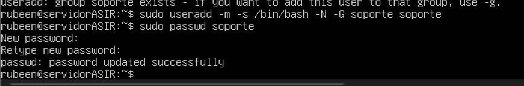
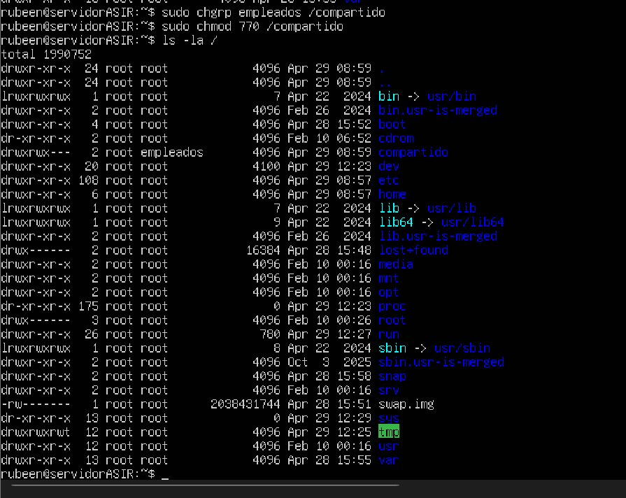
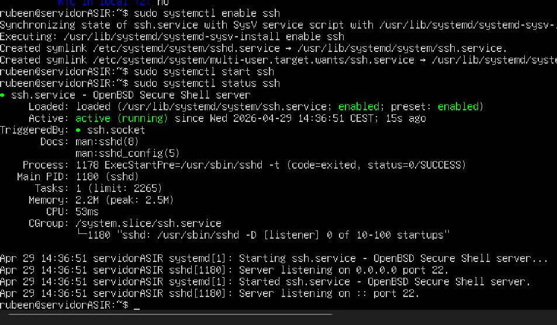

# 🐧 Implantación de Sistemas Operativos – Servidor Ubuntu

Servidor montado con **Ubuntu Server 24.04 LTS** en **VirtualBox**, con gestión de usuarios, grupos, permisos y servicio **SSH**.

**Alumno:** Rubén Campos Ibáñez · **Curso:** 1º ASIR · **Módulo:** Implantación de Sistemas Operativos

## 🛠️ Tecnologías

- Ubuntu Server 24.04 LTS
- VirtualBox
- OpenSSH Server

## 📁 Contenido del repositorio

| Fichero | Descripción |
|---|---|
| `Implantacion_Sistemas.pdf` | Documento completo del proyecto |
| `capturas/` | Capturas de pantalla de todo el proceso |

## ✅ Resumen

| Tarea | Estado |
|---|---|
| Instalación de Ubuntu Server | ✔️ Hecho |
| Configuración de hostname y zona horaria | ✔️ Hecho |
| Creación de usuarios y grupos | ✔️ Hecho |
| Carpeta compartida con permisos | ✔️ Hecho |
| Servicio SSH activo | ✔️ Hecho |

## 💻 Comandos utilizados

| Comando | Para qué |
|---|---|
| `apt update && apt upgrade` | Actualizar el sistema |
| `groupadd` / `useradd` | Crear grupos y usuarios |
| `cat /etc/group` | Comprobar los grupos y sus miembros |
| `chown` / `chmod` | Permisos de la carpeta compartida |
| `hostnamectl` | Configurar el nombre del equipo |
| `timedatectl` | Zona horaria (Europe/Madrid) |
| `ip a` | Ver la configuración de red |
| `systemctl status ssh` | Comprobar que SSH está activo |

## 📸 Capturas

### Usuarios y grupos creados

### Carpeta compartida con permisos

### Servicio SSH activo

El resto del proceso (creación de la máquina virtual, instalación, red, hostname, zona horaria…) está en la carpeta [`capturas/`](capturas/).
